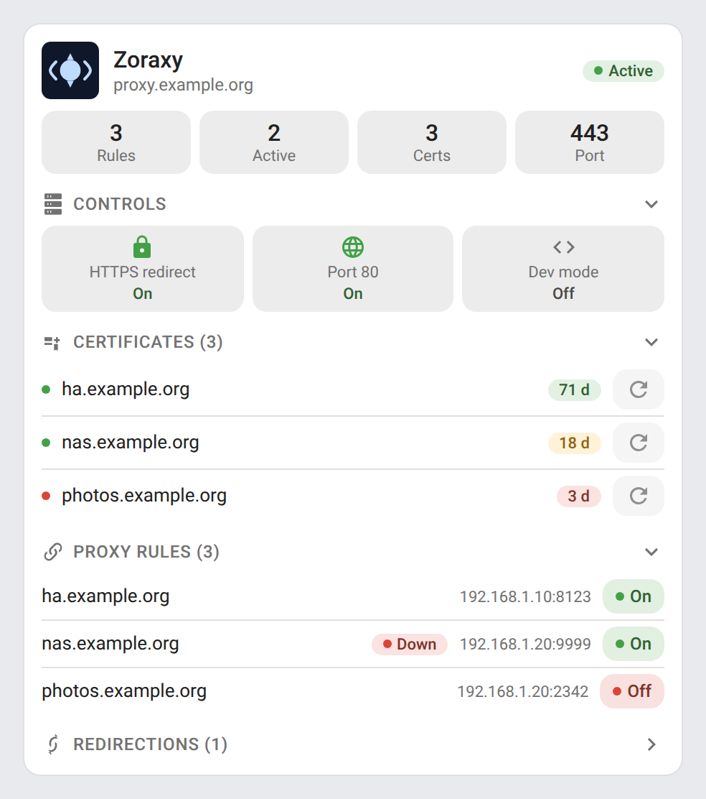
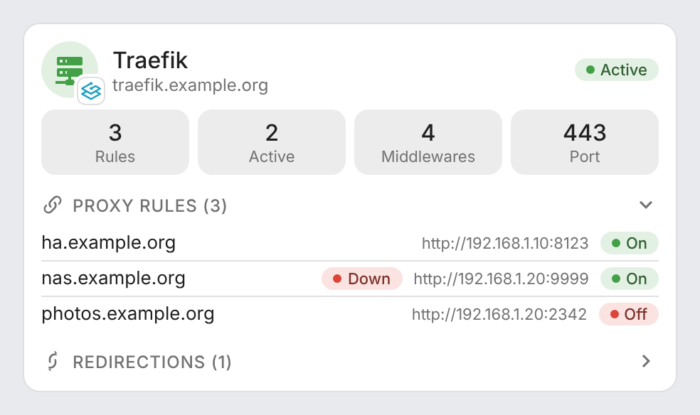
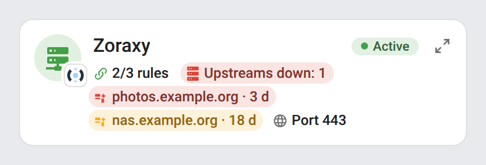
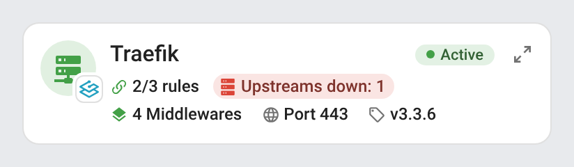
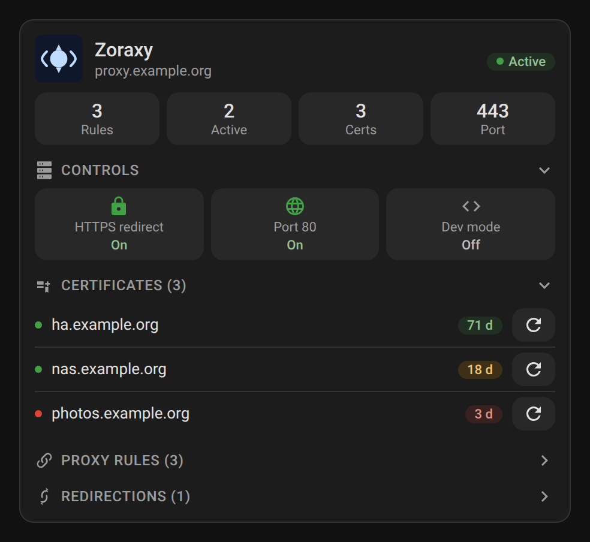
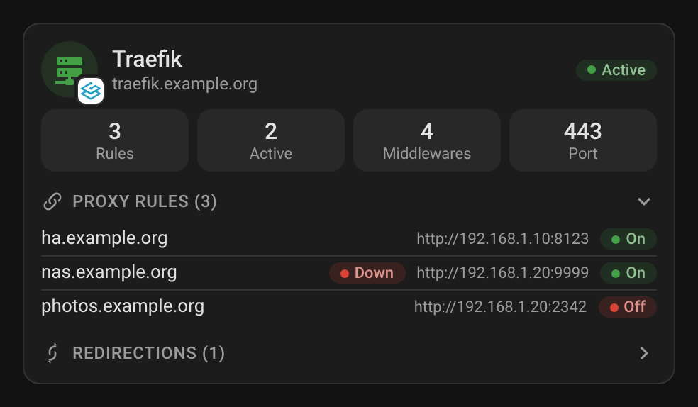
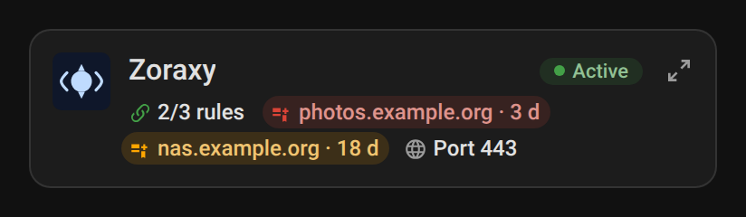
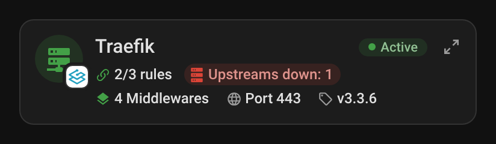
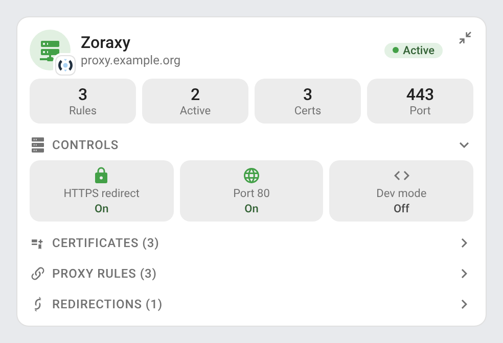
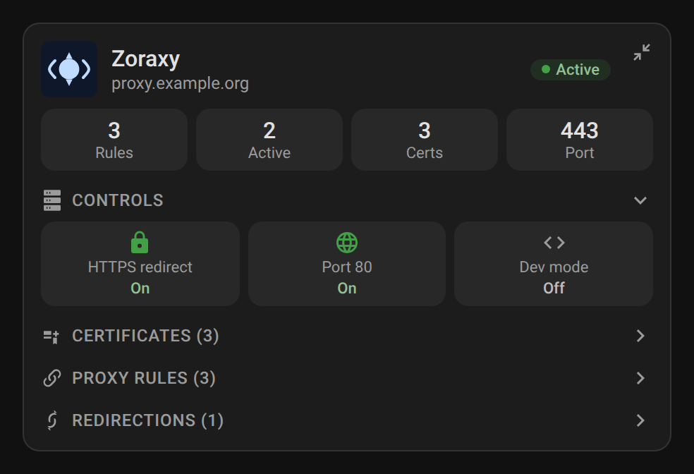

<p align="center">
  
</p>

# ha-reverse-proxy

[](https://www.home-assistant.io/integrations/marketplace/)
[](https://github.com/juju35/ha-reverse-proxy/actions/workflows/hacs.yml)
[](https://github.com/juju35/ha-reverse-proxy/actions/workflows/validate.yml)
[](https://github.com/juju35/ha-reverse-proxy/actions/workflows/lint.yml)
[](https://github.com/juju35/ha-reverse-proxy/releases/latest)
[](https://github.com/juju35/ha-reverse-proxy/blob/main/LICENSE)
[](https://buymeacoffee.com/julienstep9)

Home Assistant integration and Lovelace cards for your reverse proxy — [Zoraxy](https://github.com/tobychui/zoraxy) or [Traefik](https://traefik.io/traefik/): proxy status, proxy rules and their upstream health, redirects and, where the proxy's API allows it, controls, TLS certificates with ACME renewal and rules you can switch on and off from the dashboard. Formerly *ha-zoraxy*: see [Upgrading from ha-zoraxy](#upgrading-from-ha-zoraxy).

[](https://my.home-assistant.io/redirect/marketplace_repository/?owner=juju35&repository=ha-reverse-proxy&category=integration)

| Zoraxy | Traefik |
|---|---|
|  |  |

## Supported reverse proxies

| | Zoraxy (v3.3.2+) | Traefik (v2 / v3) |
|---|---|---|
| Proxy status, TLS flag, inbound port | ✓ | ✓ (`/api/overview`, entrypoints) |
| Proxy rules, active rules | ✓ | ✓ (HTTP routers, Traefik's own `@internal` ones aside) |
| Upstream health per rule | ✓ Zoraxy's uptime monitor | ✓ service health checks (`serverStatus`), `unknown` without a health check |
| Redirects | ✓ redirection rules | ✓ `redirectScheme` / `redirectRegex` middlewares |
| Access rules / middlewares count | access rules | middlewares |
| Version | — | ✓ |
| HTTPS redirect, port 80, dev mode switches | ✓ | — (API read-only) |
| TLS certificates, expiry, ACME renewal | ✓ | — (not exposed by the API: `acme.json`) |
| Enable / disable a rule | ✓ (`reverse_proxy.toggle_proxy_rule`) | — (API read-only) |
| Login | Zoraxy account | none, or HTTP basic auth (dashboard behind a `basicAuth` middleware) |

The cards only show the controls the proxy has.

## Features

- Sensors for proxy rules, active rules, the inbound port, and per proxy: TLS certificates and access rules (Zoraxy), middlewares and version (Traefik)
- One upstream health binary sensor per proxy rule
- **Repairs**: an issue when a certificate expires within 30 days (an error once expired), and when every upstream of a rule has been offline for 10 minutes; each goes away by itself once fixed
- Zoraxy: one expiry sensor, one "expiring soon" binary sensor and one ACME renewal button per certificate (a certificate added later in Zoraxy gets its entities at the next update); switches for the HTTPS redirect, the port 80 listener and the development mode; a `reverse_proxy.toggle_proxy_rule` action (administrators only) to enable or disable a proxy rule from an automation
- A Lovelace card, shipped with the integration and registered automatically:
  - proxy status, brand mark and key metrics
  - proxy rules with the rule's state, a *Down* badge when the proxy finds the rule's upstream offline, and redirects
  - Zoraxy: direct controls (HTTPS redirect, port 80, dev mode; turning port 80 off asks for confirmation first, as it also stops the ACME HTTP challenges), certificates with days left and a renewal button, an on/off button per rule (disabling a rule asks for confirmation first)
  - an unavailable entity shows as *Unavailable* (its control disabled), never as *Off* or *Inactive*
- A mini card in the same file: status and key figures on two lines, alerts highlighted, and a detail button showing the full card; at its narrowest (4 columns of a Sections view) the status pill shows its coloured dot only
- Visual editors for both cards, light and dark mode, English, French, German, Spanish, Serbian (Cyrillic and Latin), Italian, Dutch, European Portuguese, Polish, Romanian, Danish, Swedish, Bulgarian, Russian, Ukrainian, Hungarian, Slovak, Czech, Slovenian, Latvian and Greek
- Several instances, of either proxy, each with its own device and card
- Automatic reconnection when the Zoraxy session expires (about one hour)

## Prerequisites

- Home Assistant **2024.12** or later
- Zoraxy **v3.3.2** or later and an account on its web interface, or Traefik with its [API](https://doc.traefik.io/traefik/operations/api/) reachable from Home Assistant (`api.insecure: true` on the `traefik` entrypoint, or the dashboard router; with a `basicAuth` middleware, give the integration its credentials)

## Installation

### Via the Marketplace (recommended)

Click the button below to add the repository directly:

[](https://my.home-assistant.io/redirect/marketplace_repository/?owner=juju35&repository=ha-reverse-proxy&category=integration)

Then click **Install** and restart Home Assistant.

Or manually:

1. Open **Settings → Marketplace → Add from link** (top right; this needs a GitHub account connected)
2. Add `https://github.com/juju35/ha-reverse-proxy` — Type: **Integration**
3. Open **Reverse Proxy** and click **Install**
4. Restart Home Assistant

### Manual

1. Copy `custom_components/reverse_proxy/` from the [latest release](https://github.com/juju35/ha-reverse-proxy/releases/latest) to `/config/custom_components/reverse_proxy/`
2. Restart Home Assistant

The card file `reverse-proxy-card.js` (full card and mini card) is part of the integration: it is served at `/reverse_proxy/reverse-proxy-card.js` and added to the dashboard resources at startup (nothing is written to `/config/www/`). If the automatic registration fails, add it in **Settings → Dashboards → ⋮ → Resources**:
- URL: `/reverse_proxy/reverse-proxy-card.js`
- Type: **JavaScript Module**

### Upgrading from ha-zoraxy

Version 2.0.0 renames the integration (domain `zoraxy` → `reverse_proxy`, repository `ha-zoraxy` → `ha-reverse-proxy`). The old GitHub address redirects to the new one.

1. Update through the Marketplace (or copy `custom_components/reverse_proxy/`), make sure `custom_components/zoraxy/` is gone, restart
2. Add **Reverse Proxy → Zoraxy** for your Zoraxy address (**Settings → Devices & services → Add integration**)

The new entry takes over the former Zoraxy entry of the same address: its device, its entities (ids, names, areas, history) move to the new integration and the old entry is removed. Dashboards keep working: `custom:zoraxy-card` and `custom:zoraxy-mini-card` stay as aliases of the new cards, the `zoraxy_url` option is still read, and the card resource is replaced by the new one at startup. Automations calling `zoraxy.toggle_proxy_rule` must call `reverse_proxy.toggle_proxy_rule` instead.

## Configuration

### Integration

**Settings → Devices & services → Add integration → Reverse Proxy**, pick **Zoraxy** or **Traefik**, then fill in:

| Field | Zoraxy | Traefik |
|---|---|---|
| Address | `http://zoraxy.local:8000` | `http://traefik.local:8080` (the API entrypoint or the dashboard address) |
| Username / Password | Your Zoraxy credentials | Only when the API or dashboard is behind a `basicAuth` middleware |
| Refresh interval | `30` seconds (10 minimum) | same |
| Verify the TLS certificate | On by default; turn it off only for an `https://` address with a self-signed certificate | same |

The refresh interval and the TLS verification can be changed later with **Configure** on the integration. To change the address, the username or the password without removing the integration, use **⋮ → Reconfigure** on it: the new settings are saved only once the proxy accepts them. When the proxy refuses the credentials, Home Assistant asks for new ones in **Settings → Devices & services**. Zoraxy entries created with version 1.5.0 or earlier keep the TLS verification off, as before; turn it on in the options if your certificate is valid.

### Card

Edit a dashboard, click **Add card** and search for **Reverse Proxy Card**. Set the proxy URL (opened when clicking the header icon) and, with several instances, the device. Or in YAML:

```yaml
type: custom:reverse-proxy-card
proxy_url: http://zoraxy.local:8000
```

| Option | Default | Description |
|---|---|---|
| `device` | — | Device id of the proxy instance to show, picked in the visual editor; left out, the instance whose entity ids start with `entity_prefix`, else the first one |
| `proxy_url` | — | The proxy's web interface (`http://` or `https://`), opened from the header icon and shown under the title (`zoraxy_url`, the option's name up to 1.14.x, is still read) |
| `show_title` | `true` | Show the title in the header (e.g. `false` under a section heading of your own) |
| `show_subtitle` | `true` | Show the subtitle under the title |
| `entity_prefix` | `zoraxy_reverse_proxy_zoraxy` | Common part of the entity ids of a Zoraxy install of 1.x: picks the instance when `device` is left out, and finds the entities when the entity registry is not available |
| `language` | Auto | Force the card language: `en`, `fr`, `de`, `es`, `sr`, `sr-Latn`, `it`, `nl`, `pt`, `pl`, `ro`, `da`, `sv`, `bg`, `ru`, `uk`, `hu`, `sk`, `cs`, `sl`, `lv` or `el` (by default, the Home Assistant language) |

The card finds its entities in the entity registry, by their device and their kind, so renamed entity ids keep working, and reads which proxy the device is (and what its API allows) from the *Proxy running* binary sensor: a Traefik card has no controls, certificates or rule buttons. With several instances, pick the device of each card in the visual editor (or set `device`).

### Mini card

`custom:reverse-proxy-mini-card` shows the full card's essentials on two lines, for a compact dashboard: the header icon, title and status pill, then a chip per key figure:

- active / total proxy rules
- the number of rules whose upstream is down, in red, only when there are some
- Zoraxy: the number of certificates, or one chip per certificate expiring within 30 days (orange, red under 7 days), the closest first; Traefik: the number of middlewares
- the inbound port
- Zoraxy: *HTTPS redirect Off* and *Dev mode On*, in orange, only when they apply; Traefik: the version

Chips needing attention are tinted; a click on a chip opens its entity. The **detail** button (top right) switches the card to the full [card](#card), with the same configuration, and back, as does a click anywhere else on the page (`zoom: false` removes it). Search for **Reverse Proxy Mini Card** when adding a card, or in YAML:

```yaml
type: custom:reverse-proxy-mini-card
proxy_url: http://zoraxy.local:8000
zoom: true
```

Same options as the full card, plus:

| Option | Default | Description |
|---|---|---|
| `zoom` | `true` | Detail button switching to the full card and back |

| Zoraxy | Traefik |
|---|---|
|  |  |

### Entities

Every proxy:

| Entity | Description |
|---|---|
| `sensor.* proxy rules` | Number of proxy rules (rules and redirects as attributes) |
| `sensor.* active rules` | Active proxy rules |
| `sensor.* inbound port` | Proxy listening port (Traefik: the `websecure` entrypoint, else the first TLS entrypoint, else the first one) |
| `binary_sensor.* proxy running` | Proxy running; `proxy_type` and `features` attributes tell the cards which proxy it is |
| `binary_sensor.* TLS enabled` | TLS enabled (Traefik: a router or an entrypoint with TLS) |
| `binary_sensor.* {domain} upstream` | Upstream health of a proxy rule (problem): `on` when the proxy found an upstream of the rule offline at its last check, `unknown` when it has no check of the rule; `upstreams` attribute with each upstream's URL and online flag (Zoraxy adds the status code, latency and check time) |

Zoraxy only:

| Entity | Description |
|---|---|
| `sensor.* TLS certificates` | Number of TLS certificates |
| `sensor.* access rules` | Number of access rules |
| `sensor.* {domain} certificate` | Certificate expiry date |
| `binary_sensor.* {domain} certificate expiring` | `on` when the certificate expires in less than 30 days |
| `button.* renew {domain}` | Triggers the ACME renewal (HTTP challenge). A wildcard certificate (listed by Zoraxy as `_.example.org`) needs a DNS challenge: renew it in Zoraxy, the button only explains it |
| `binary_sensor.* HTTPS redirect`, `switch.* HTTPS redirect` | HTTP → HTTPS redirect, and its switch |
| `binary_sensor.* port 80 listener`, `switch.* port 80 listener` | Listening on port 80, and its switch |
| `binary_sensor.* development mode`, `switch.* development mode` | Development mode (no cache), and its switch |

Traefik only:

| Entity | Description |
|---|---|
| `sensor.* middlewares` | Number of HTTP middlewares (Traefik's own `@internal` ones aside) |
| `sensor.* version` | Traefik version (diagnostic; also the device's software version) |

Names follow the Home Assistant language under the **Zoraxy Reverse Proxy** or **Traefik Reverse Proxy** device. Zoraxy entity ids keep their historical French suffixes (`sensor.zoraxy_reverse_proxy_zoraxy_regles_proxy`…) so dashboards and automations from 1.x keep working, on new installs too; Traefik entities get Home Assistant's default ids (`sensor.traefik_reverse_proxy_proxy_rules`…).

### Repairs

The integration raises issues in **Settings → Repairs**, removed by themselves once the cause is gone:

| Issue | When | Severity |
|---|---|---|
| Certificate of *domain* expires soon | A certificate expires within 30 days (the *expiring soon* binary sensor is on) | Warning |
| Certificate of *domain* expired | Its expiry date has passed | Error |
| *domain* unreachable behind *proxy* | Every upstream of the rule has been offline at each check for 10 minutes (a service restarting raises nothing) | Error |

They follow the proxy's data: while the proxy itself can't be reached, the issues raised stay as they are. Removing the integration entry removes its issues.

### Action `reverse_proxy.toggle_proxy_rule` (Zoraxy)

| Parameter | Type | Required | Description |
|---|---|---|---|
| `domain` | `string` | yes | Domain of the rule (e.g. `myapp.example.com`) |
| `enable` | `boolean` | no | `true` to enable, `false` to disable; left out, the rule is toggled |
| `config_entry_id` | `string` | no | The instance (config entry) the rule belongs to; left out, the instance that lists the domain |

The action is reserved to administrators. It fails (and the card's button goes back) when the rule is not found or the proxy refuses the change; for a Traefik rule it fails too, as Traefik's API is read-only. With several instances, the rule is looked up in all of them, unless `config_entry_id` names one.

```yaml
action: reverse_proxy.toggle_proxy_rule
data:
  domain: myapp.example.com
  enable: false
```

## Screenshots

| Full card, Zoraxy (certificates and proxy rules open) | Full card, Zoraxy, dark |
|---|---|
|  |  |

| Full card, Traefik (proxy rules open) | Full card, Traefik, dark |
|---|---|
|  |  |

| Mini card, Zoraxy | Mini card, Zoraxy, dark |
|---|---|
|  |  |

| Mini card, Traefik | Mini card, Traefik, dark |
|---|---|
|  |  |

| Mini card zoomed in | Mini card zoomed in (dark) |
|---|---|
|  |  |

## How it works

The integration polls the proxy's API at the refresh interval. Zoraxy: it logs in to the web API and logs in again when the session expires; the uptime monitor's results (`/api/utm/list`) are read at most once a minute (Zoraxy itself checks each upstream every 5 minutes, every 30 seconds while it is down). Traefik: `/api/overview`, the HTTP routers, services, middlewares and entrypoints are read at each poll, the version once an hour. The entities of a certificate or proxy rule added in the proxy appear at the next update, without reloading the integration, and those of a removed one are deleted.

On the card, the button next to each Zoraxy rule calls `reverse_proxy.toggle_proxy_rule` for the card's own instance; for users who are not administrators the button only shows the rule's state and is disabled, and a failed change shows its error in a toast; the button updates at once and the card refreshes when the integration has polled the proxy again. Certificates turn orange under 30 days and red under 7 days.

To debug:

```yaml
logger:
  logs:
    custom_components.reverse_proxy: debug
```

**⋮ → Download diagnostics** on the integration gives its settings and the last data read from the proxy, with the address, usernames, passwords, tokens, secrets, cookies and email addresses replaced by `**REDACTED**`.

## Development

```bash
pip install playwright pillow && playwright install chromium
python scripts/screenshots.py   # renders both cards, for Zoraxy and Traefik, with mock entities into screenshots/ (CHROMIUM_PATH: an installed Chromium)
```

### Releasing

1. Bump the version in `custom_components/reverse_proxy/manifest.json` and `REVERSE_PROXY_CARD_VERSION` in the card
2. Add a `## <version>` section at the top of [CHANGELOG.md](https://github.com/juju35/ha-reverse-proxy/blob/main/CHANGELOG.md)
3. Push to `main`: the **Release** workflow creates the tag and the GitHub release with the changelog section as notes

## Translations

The integration and the card follow the language of Home Assistant (the card's `language` option can force another one). Currently supported:

| Language | Code |
|---|---|
| English | `en` |
| Français | `fr` |
| Deutsch | `de` |
| Español | `es` |
| Српски | `sr` |
| Srpski (latinica) | `sr-Latn` |
| Italiano | `it` |
| Nederlands | `nl` |
| Português (Portugal) | `pt` |
| Polski | `pl` |
| Română | `ro` |
| Dansk | `da` |
| Svenska | `sv` |
| Български | `bg` |
| Русский | `ru` |
| Українська | `uk` |
| Magyar | `hu` |
| Slovenčina | `sk` |
| Čeština | `cs` |
| Slovenščina | `sl` |
| Latviešu | `lv` |
| Ελληνικά | `el` |

Brazilian Portuguese (`pt-BR`): pt-BR uses the European Portuguese texts, in the integration (`pt-BR.json` is a copy of `pt.json`) and in the card. Contributions for additional languages are welcome!

## License

[MIT](https://github.com/juju35/ha-reverse-proxy/blob/main/LICENSE)

## Support

If you find this project useful, you can support its development:

<a href="https://buymeacoffee.com/julienstep9"></a>
